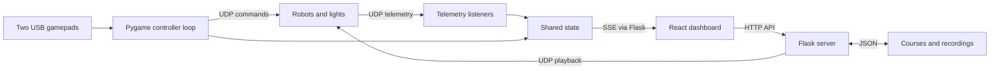

# E-Waste E-Motion

**Robot and lighting control for a theatrical production.**

Python · Flask · React · TypeScript · UDP · Pygame

[Watch the performance](https://www.youtube.com/watch?v=oUAgcPvxwfg) · [Production](https://www.teatrulgeorgeciprian.ro/e-waste-e-motion/) · [Technical notes](docs/architecture.md)

This repository preserves the control software for *E-Waste E-Motion: A Robofable*, a 2025 theatre project in which robotic characters inhabit a future recycling centre. The production explores electronic waste and our attachment to intelligent devices. It was organised by Teatrul „George Ciprian”, with UNATC as its main partner. [Production details and credits](https://www.teatrulgeorgeciprian.ro/e-waste-e-motion/).

My contribution was **robot and lighting programming**, credited as Antonie Amir Suciu. This code connects physical gamepads, a browser interface, and networked devices so that movements can be rehearsed, recorded, arranged, and replayed.

## What it does

- **Live control:** assign robots to two physical gamepads, with exclusive assignment between controllers.
- **Recording:** capture robot telemetry into timed movement segments.
- **Timeline editing:** create courses, arrange recorded moves, and save choreography.
- **Playback:** replay an individual move or a saved course across devices.
- **Lighting:** send LED cues, servo values, and device-specific brightness commands, including configured fanout targets.
- **Live feedback:** stream controller and telemetry state to the browser using server-sent events.

The archived backend configures 14 robot IDs. The timeline editor displays tracks for IDs 1–10; see [baseline limitations](docs/architecture.md#baseline-limitations) for differences between the views.

## How it fits together



## Run locally

The original environment used Python 3.11 on ARM Linux. Python 3.12 is the software-check target; Node.js 22 is the frontend CI target. Robot firmware and hardware are separate from this repository.

From the repository root:

```bash
python3 -m venv .venv
source .venv/bin/activate
python -m pip install -r requirements.txt

cd frontend
npm ci --no-audit --no-fund
npm run build
cd ..
```

The frontend build writes `static/bundle.js` and `static/style.css`, which Flask serves through `templates/index.html`.

For a **software-only preview**, start the app factory without the hardware threads:

```bash
cd src
../.venv/bin/python -m flask --app 'app:create_app()' run --host 127.0.0.1 --port 5000
```

Open <http://127.0.0.1:5000>. The dashboard and course editor work without controllers; telemetry and recording require the hardware loops. Recording and playback API calls can still send real UDP commands in preview mode.

For **hardware operation**, first configure robot addresses, joystick paths, and servo assignments in [`src/config.py`](src/config.py). Then, from the repository root:

```bash
cd src
../.venv/bin/python app.py
```

This starts the controller and telemetry threads and serves on port 5000. It retains the original debug server and permissive CORS settings; operate it on a trusted local control network. UI power/disable switches are display state only and do not stop the backend controller loop.

**Launch from `src/`.** Storage paths are relative to the working directory. New courses are saved in root-level `courses.json` and `recordings/`, both excluded from Git.

## Original recording

[`examples/`](examples/) contains the archived `testfinal` course and its recording, unchanged. To load it into a fresh local workspace, run these commands from the repository root **before starting the server**:

```bash
cp -n examples/courses.json courses.json
mkdir -p recordings
cp -n examples/recordings/*.json recordings/
```

The `-n` flag preserves existing files. Keep your own recordings backed up separately.

## Verification

```bash
bash scripts/check.sh
# Or run a single part:
bash scripts/check.sh backend
bash scripts/check.sh frontend
```

The tests use temporary storage and mocked sockets. They check course persistence, exclusive controller assignment, event-stream serialization, loading the archived example, and playback packet fields. GitHub Actions calls the same script after installing dependencies. The script automatically uses `.venv/bin/python` when present; `PYTHON_BIN` can override it.

Checks were introduced during this repository import. The full local check script passed with installed dependencies: seven backend tests, Python compilation, and the frontend production build. Python dependency consistency also passed `pip check`. Browser behavior, hardware operation, and hosted CI remain unverified. See [the verification record](docs/archive-import.md#local-verification) for the scope and limitations.

These checks do not validate physical movement, timing accuracy, or device firmware. Vite builds TypeScript by transpilation; the archive has no separate type-check configuration.

## Repository map

| Path | Purpose |
| --- | --- |
| `src/` | Flask API, controller loop, UDP telemetry, playback, and persistence |
| `frontend/` | React dashboard, live controller display, and timeline editor |
| `templates/` | Flask HTML shell for the built frontend |
| `examples/` | Original course and recording |
| `tests/` | Hardware-free software checks |
| `docs/` | Architecture, provenance, and production sources |

## Production credits

| Role | Credit |
| --- | --- |
| Concept, text, direction | Marina Hanganu |
| Robot movement and voices | Smaranda Găbudeanu |
| Technical design and robot construction | Marius Dumitrescu |
| Robot and lighting programming | Antonie Amir Suciu |
| Scenography and robot artistic design | Maria Mandea (super:serios) |
| New media, video, interactive installation | Cristina Bodnărescu (Ethics of Joy) |
| Sound design, music, AI voices | George Urse (Ethics of Joy) |
| Technician and scenography assistant | Adrian Dragoman |

Credits follow the [official production page](https://www.teatrulgeorgeciprian.ro/e-waste-e-motion/). The broader production includes artistic work and hardware beyond the software preserved here. See the [project context](docs/project-context.md) for the brochure and audience research report.

## Archive status

This is a logical import of the completed project from `cineticfinal.zip`. Commit boundaries group related subsystems; they do not reconstruct the original development chronology. Application source, frontend manifests, and the example recording are preserved unchanged. Environments, dependency directories, compiled bundles, and static backups are excluded. [Import details](docs/archive-import.md).

No repository-wide licence has been selected. The original frontend manifest contains an ISC label; that alone does not establish permissions for the complete project or production materials.
