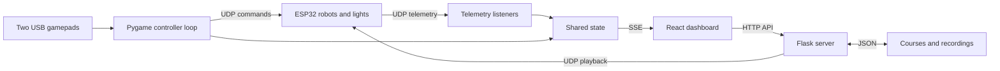

# E-Waste E-Motion

**Robot and lighting control for a theatre production.**

Python · Flask · React · TypeScript · ESP32 · UDP · Pygame

[Watch the performance](https://www.youtube.com/watch?v=oUAgcPvxwfg) · [Production](https://www.teatrulgeorgeciprian.ro/e-waste-e-motion/) · [Architecture](docs/architecture.md) · [Firmware](firmware/README.md)

*E-Waste E-Motion: A Robofable* is a 2025 theatre production in which robotic characters inhabit a future recycling centre, exploring electronic waste and our attachment to intelligent devices. It was organised by Teatrul „George Ciprian”, with UNATC as its main partner.

My contribution was **robot and lighting programming**, credited as Antonie Amir Suciu. This repository holds that software: a control host that connects two physical gamepads, a browser dashboard, and networked robots and lights, so that movements can be rehearsed, recorded, arranged on a timeline, and replayed during the show.

## Features

| | |
| --- | --- |
| **Live control** | Drive any robot from one of two USB gamepads. A robot belongs to one controller at a time. |
| **Recording** | Capture each robot's telemetry (encoders, gyro, commands) as timed movement segments. |
| **Timeline editor** | Build a course by recording moves per robot on a shared timeline, then save it. |
| **Playback** | Replay a single move or a whole course. Robots follow the recorded encoder ticks and heading, not just the stick inputs. |
| **Lighting** | LED cues, servo values and brightness control, with fan-out to extra light controllers. |
| **Live feedback** | Controller input and per-robot telemetry are streamed to the browser over server-sent events. |

## Architecture



The control host (a Raspberry Pi in production) runs the Flask server, the gamepad loop and the telemetry listeners in one process. Robots are ESP32 boards that speak JSON over UDP: commands on port 12345, telemetry on 12346. The protocol is documented in [firmware/README.md](firmware/README.md#wire-protocol-json-over-udp), and the host side is described in [docs/architecture.md](docs/architecture.md).

## Getting started

Requirements: Python 3.11+ (3.12 is the CI target), Node.js 22, and for the robots the Arduino-ESP32 core.

```bash
# Backend
python3 -m venv .venv
source .venv/bin/activate
python -m pip install -r requirements.txt

# Frontend (builds into static/, which Flask serves)
cd frontend
npm ci --no-audit --no-fund
npm run build
cd ..
```

### Software-only preview

Runs the dashboard and course editor without gamepads or telemetry threads:

```bash
cd src
../.venv/bin/python -m flask --app 'app:create_app()' run --host 127.0.0.1 --port 5000
```

Open <http://127.0.0.1:5000>. Recording and playback calls still send real UDP packets, so run this away from the show network if robots are powered.

### Show mode

1. Configure robot addresses, joystick paths and servo assignments in [`src/config.py`](src/config.py).
2. Flash each drive robot with the [firmware](firmware/README.md), setting its `ROBOT_ID`, and reserve its IP on the router.
3. Start the host from `src/` (storage paths are relative to it):

```bash
cd src
../.venv/bin/python app.py
```

This serves on port 5000 with the controller and telemetry threads running. Courses are saved to `courses.json` and `recordings/` in the repository root, both gitignored.

> **Safety:** the server runs Flask in debug mode with permissive CORS and no authentication. Use it only on a trusted, isolated control network. The browser has no emergency stop: clearing a controller's robot stops commands to it, and every robot halts on its own when no command arrives for 300 ms.

### Load the original recording

[`examples/`](examples/) contains the `testfinal` course used in production. Copy it in before starting the server; `-n` never overwrites existing files:

```bash
cp -n examples/courses.json courses.json
mkdir -p recordings
cp -n examples/recordings/*.json recordings/
```

## Tests

```bash
bash scripts/check.sh            # everything
bash scripts/check.sh backend    # Flask API, storage, packet format (mocked sockets)
bash scripts/check.sh firmware   # host-side tests of firmware logic
bash scripts/check.sh frontend   # production build
```

GitHub Actions runs the same script. The checks cover software behaviour only: course persistence, exclusive controller assignment, event-stream serialization, playback packet fields, client-side route fallback and encoder counter arithmetic. They do not validate physical movement, timing accuracy or firmware on real hardware.

## Repository map

| Path | Purpose |
| --- | --- |
| `src/` | Flask API, gamepad loop, UDP telemetry, playback, persistence |
| `frontend/` | React dashboard, controller panel, timeline editor |
| `firmware/` | ESP32 drive-robot firmware (Arduino sketch) and host tests |
| `templates/` | Flask HTML shell for the built frontend |
| `examples/` | Original production course and recording |
| `tests/` | Hardware-free backend tests |
| `scripts/` | Check runner used locally and in CI |
| `docs/` | Architecture, import provenance, production context |

## Production credits

| Role | Credit |
| --- | --- |
| Concept, text, direction | Marina Hanganu |
| Robot movement and voices | Smaranda Găbudeanu |
| Technical design and robot construction | Marius Dumitrescu |
| Robot and lighting programming | Antonie Amir Suciu |
| Scenography and robot artistic design | Maria Mandea (super:serios) |
| New media, video, interactive installation | Cristina Bodnărescu (Ethics of Joy) |
| Sound design, music, AI voices | George Urse (Ethics of Joy) |
| Technician and scenography assistant | Adrian Dragoman |

Credits follow the [official production page](https://www.teatrulgeorgeciprian.ro/e-waste-e-motion/). The production includes artistic work and hardware beyond this software; see the [project context](docs/project-context.md) for the brochure and audience research.

## Provenance and licence

The host software was imported from the completed project archive (`cineticfinal.zip`); [import details](docs/archive-import.md). Commit boundaries in that import group subsystems and do not reconstruct the original chronology. Later commits add the drive-robot firmware and fix issues listed in [docs/architecture.md](docs/architecture.md#baseline-limitations).

No repository-wide licence has been chosen yet. The frontend manifest's ISC label does not by itself grant rights to the whole project or the production materials.
